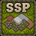
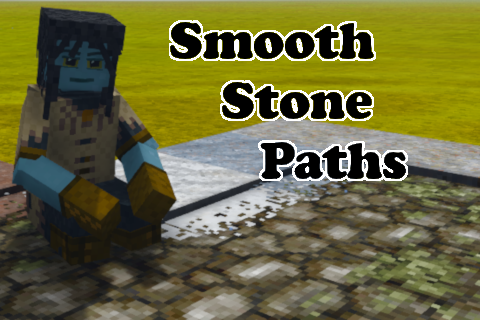

<p align="center">
  
</p>

<h1 align="center">Smooth Stone Paths</h1>

<p align="center">
  A Vintage Story mod that blends the edges of stone paths into the grass, sand, gravel and dirt around them.
</p>

<p align="center">
  
</p>

## What it does

Vanilla stone paths end in a hard, straight edge against the ground beside them. Smooth Stone Paths lets the neighbouring ground creep a little way onto the path, so a path through a meadow looks worn into the grass rather than carved through it.

The edge is drawn from what is actually next to each path block:

- **Grass** spreads onto the path in the same tint as the grass around it, following the local climate and season.
- **Sand and gravel** use the texture of their own rock type, so granite sand looks like granite sand.
- **Dirt** uses the texture of its own fertility.
- **Corners and seams** blend: where two different materials meet, the edge mixes them instead of switching abruptly.
- **Variation**: about one path block in four has one side where the overgrowth reaches further, and the edge speckle varies from block to block, so long paths don't look stamped.

Built surfaces such as packed dirt, rammed earth, cob and mud bricks are treated like stone and get no edge. Neither does ground that is covered by another block, such as dirt under a slab or stairs.

It works on paths you have already placed. It adds no new blocks and saves nothing to your world, so you can remove it at any time.

## Installation

1. Download the latest `smoothstonepaths_<version>.zip` from the [releases](https://mods.vintagestory.at/smoothstonepaths#tab-files).
2. Put the zip, unextracted, in your `VintagestoryData/Mods` folder or use the `1-click install` method.
3. On a server, install it on the server in the `./data/Mods` folder (NOT the folder that contains the base game .dlls). Every client that connects will be prompted to download it.

Requires Vintage Story 1.22.

## Configuration

The mod creates `ModConfig/smoothstonepaths.json` in your `VintagestoryData` folder the first time it runs:

```json
{
  "TerrainBlending": false
}
```

- **TerrainBlending** (off by default): also blend natural terrain into itself. Only the tops of blocks open to the sky are affected.
  - Grass grows onto the edges of sand, wavy sand, gravel, rock, bare soil (the `none` grass coverage only), bony soil, devastated soil, packed dirt, arid packed dirt, trampled earth and rammed earth.
  - Sand spills onto gravel.
  - Soil that already has grass on it is left alone.
  - Turning it on changes how these blocks are drawn, so exposed rock in particular can make chunks a little slower to build.

On a server, the server's setting applies to every player. Restart the game or server after changing it.

## Compatibility

- Affects full-height stone paths. Stone path slabs, stairs and full-block stone paths are left as they are.
- Works with [Add Some Paths](https://mods.vintagestory.at/addsomepaths): its gravel paths and packed dirt paths get the same blended edges. Their slabs are left as they are. Nothing changes if you don't have that mod installed.
- Paths never blend into each other: a stone path next to a gravel path keeps a clean edge.
- Mods that replace or patch the vanilla stone path files may conflict with it, or keep their own paths from getting the blended edge.

## Known limitations

- If you place or remove a block on top of the ground beside a path, the path's edge can occasionally stay out of date until that area reloads.

## Building from source

The project targets .NET 10 and needs both a Vintage Story and Visual Studio 2026 installation.

1. Load the `SmoothStonePaths.slnx` in Visual Studio.
2. Press `CTRL + SHIFT + B` to build from source.

If the build process cannot find your game files, reinstall the game or manually set your `VINTAGE_STORY` environment variable to the correct path.

To debug:

1. Right-click `SmoothStonePaths` in the Solution Explorer tab.
2. Select `Debug > Start New Instance`.

The packaged mod is written to `Releases/smoothstonepaths_<version>.zip` when you run the CakeBuild project. CakeBuild uses Cake (C# Make), a cross-platform build automation tool whose build scripts are written in C#.

The edge masks, shapes and the blocktype patch are generated by `tools/Generate-FringeAssets.ps1` (Windows PowerShell). Run it after changing the mask settings or the lists of rocks and soil fertilities, then rebuild.
